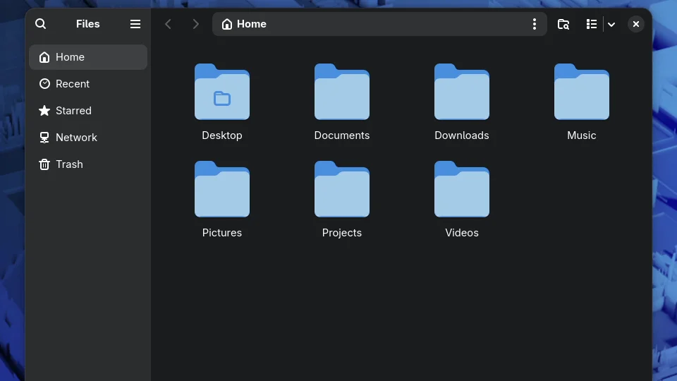
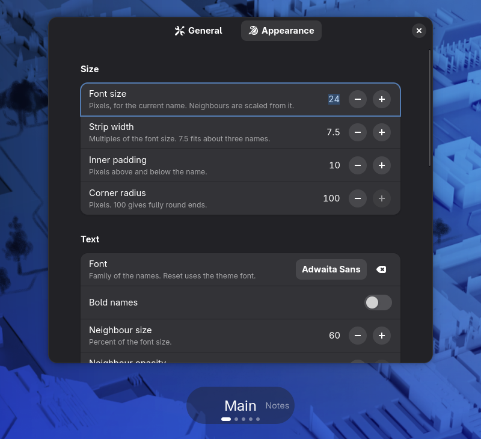

# Workspace Ticker

See where you landed. Whenever you switch workspaces, a small strip of
workspace names appears at the bottom of the screen: the current one large in
the middle, its neighbors smaller on either side. The strip slides to the new
workspace, holds for a moment, then fades away.



## Features

- **Names instead of dots.** GNOME's own switcher only shows dots, so with
  more than a few workspaces you end up counting. This shows their names.
- **Smooth.** The strip slides from name to name, and a quick run of switches
  carries on from wherever it is, without jumping.
- **Out of the way.** It disappears on its own, never takes clicks, and stays
  hidden in the Activities overview and over fullscreen windows.
- **Knows your dock.** With Dash to Dock or Ubuntu Dock at the bottom, it sits
  just above it.
- **Yours to style.** Size, font, dots, border, shadow, background blur and
  colors are all adjustable, with a live preview while you change them.

| Default | Blur, border and shadow | Custom colors |
|---|---|---|
|  |  |  |

## Requirements

GNOME Shell 50.

## Install

1. Download `workspace-ticker@idogr.shell-extension.zip` from the
   [latest release](https://github.com/idogrf/workspace-ticker/releases/latest).
2. Install it:

   ```bash
   gnome-extensions install --force ~/Downloads/workspace-ticker@idogr.shell-extension.zip
   ```

3. Log out and log back in. GNOME only picks up newly installed extensions at
   login.
4. Turn it on in the **Extensions** app, or with:

   ```bash
   gnome-extensions enable workspace-ticker@idogr
   ```

To update, repeat steps 1 to 3 with the new release.

## Name your workspaces

Workspace Ticker shows the names GNOME already stores for your workspaces.
The easiest way to set them is the
[Space Bar](https://extensions.gnome.org/extension/5090/space-bar/)
extension, which lets you rename workspaces from the top bar. Without it, set
them from a terminal, one name per workspace in order:

```bash
gsettings set org.gnome.desktop.wm.preferences workspace-names "['Main', 'Mail', 'Code']"
```

Workspaces without a name show their number.

## Settings

Open the settings from the gear icon in the **Extensions** app, or with
`gnome-extensions prefs workspace-ticker@idogr`. While the window is open the
strip stays on screen, and every change shows on it right away.

- **General:** how long the strip stays up, how fast it slides, where it sits
  (above the dock or a distance from the bottom of the screen), and the label
  for unnamed workspaces.
- **Appearance:** size, font, bold names, how large the neighboring names
  are, the position dots, corner radius, border, shadow, background blur and
  custom colors.



## Troubleshooting

- **GNOME's own dots cover the strip for a moment after a switch.** Raise
  **Distance from bottom** (to about 30) or, with a dock, **Gap above dock**
  (to about 60) in the General page.
- **The strip doesn't appear in the overview or over a fullscreen video.**
  That's on purpose.

## Uninstall

```bash
gnome-extensions uninstall workspace-ticker@idogr
dconf reset -f /org/gnome/shell/extensions/workspace-ticker/
```

The second line removes its saved settings.

## Build from source

```bash
git clone https://github.com/idogrf/workspace-ticker.git
cd workspace-ticker
sh pack.sh
```

This writes `dist/workspace-ticker@idogr.shell-extension.zip`. Install it as
in step 2 above.

## License

GPL-2.0-or-later. See [LICENSE](LICENSE).
